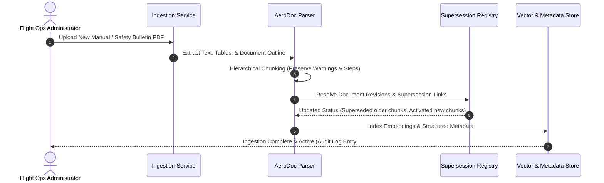
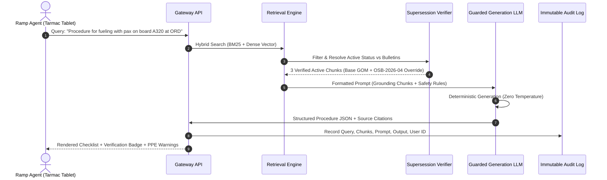

# System Architecture & Initial RAG Design Document
## SkyOps Intelligence: High-Integrity Procedure Retrieval Engine

**Document Status:** Approved Baseline  
**Architecture Identifier:** SKY-ARCH-001  
**Target Milestone:** 3.37 (Initial RAG Architecture & Ingestion Design)  
**Applicable Milestones:** 3.1, 3.8, 3.37  
**Effective Date:** 2026-10-27  
**Author:** Airline AI Architecture & Ground Safety Systems Team  

---

## 1. Architecture Overview & Core Principles

SkyOps Intelligence is engineered around one supreme operational constraint: **Aviation Safety Compliance**. Unlike general conversational RAG applications, where slight imprecision or creative phrasing is acceptable, an airline ground operations assistant must function as a deterministic, auditable, and low-latency procedure verification engine.

### 1.1 Architectural Pillars
1. **Zero-Stale Guarantee (Deterministic Supersession):** No superseded, expired, or draft procedure chunk shall ever be emitted to an operational user.
2. **Deterministic Citation Traceability:** Every factual statement, checklist step, and caution must be bidirectionally anchored to an authoritative document, chapter, section, and effective date.
3. **Fail-Closed Safety Guardrails:** When queries lack sufficient verified procedural documentation or produce ambiguous retrieval candidates, the system refuses generation and routes to human leadership.
4. **Sub-3-Second Edge Latency:** Optimized hybrid search, prompt compaction, and aggressive caching enable real-time turnaround responses on ramp-rugged devices.

---

## 2. High-Level Architecture Diagram

```
+----------------------------------------------------------------------------------------------------+
|                                    1. INGESTION & DOCUMENT PIPELINE                                |
|                                                                                                    |
|  +--------------------+   +-----------------------+   +-------------------+   +-----------------+  |
|  | Flight Ops / GOM   |   | Safety Action Notices |   | Regulatory ADs /  |   | Local Station   |  |
|  | Manuals (PDF/SGML) |   | & Bulletins (PDF/DOC) |   | NOTAMs (FAA/EASA) |   | SOPs (LOP Docs) |  |
|  +---------+----------+   +-----------+-----------+   +---------+---------+   +--------+--------+  |
|            |                          |                         |                      |           |
|            +--------------------------+------------+------------+----------------------+           |
|                                                    v                                               |
|                             +---------------------------------------------+                        |
|                             |   AeroDoc Parser & Semantic Structure Normalizer   |                 |
|                             |   (Section, Sub-step, Caution, Table Extractor) |                    |
|                             +----------------------+----------------------+                        |
|                                                    |                                               |
|                                                    v                                               |
|                             +---------------------------------------------+                        |
|                             |   Metadata Enrichment & Validity Validator  |                        |
|                             |   (Doc ID, Version, Effective Dates, Status) |                       |
|                             +----------------------+----------------------+                        |
|                                                    |                                               |
|                                                    v                                               |
|                             +---------------------------------------------+                        |
|                             |   Supersession Graph & Registry Linker      |                        |
|                             |   (Links replaces/amends DAG relationships) |                        |
|                             +----------------------+----------------------+                        |
|                                                    |                                               |
|                             +----------------------+----------------------+                        |
|                             |                                             |                        |
|                             v                                             v                        |
|               +----------------------------+               +-------------------------------+       |
|               |  Vector Embeddings Model   |               |   Document Metadata & Graph   |       |
|               |  (text-embedding-3-large)  |               |   Postgres + pgvector / Graph |       |
|               +-------------+--------------+               +---------------+---------------+       |
|                             |                                              |                       |
+-----------------------------|----------------------------------------------|-----------------------+
                              |                                              |
                              +--------------------+    +--------------------+
                                                   |    |
+--------------------------------------------------v----v--------------------------------------------+
|                                    2. RETRIEVAL & VERIFICATION PIPELINE                            |
|                                                                                                    |
|  +-----------------------------------------------------------------------------------------------+ |
|  | User Operational Query (e.g. Ramp Agent at ORD: "A321neo fuel spill on apron procedure")       | |
|  +-----------------------------------------------+-----------------------------------------------+ |
|                                                   |                                                |
|                                                   v                                                |
|                   +--------------------------------------------------------------+                 |
|                   |   Query Contextualizer & Parameter Normalizer                |                 |
|                   |   (Extracts: Station=ORD, Fleet=A321neo, Topic=Spill, Role)  |                 |
|                   +-------------------------------+------------------------------+                 |
|                                                   |                                                |
|                                                   v                                                |
|                   +--------------------------------------------------------------+                 |
|                   |   Hybrid Multi-Stage Search Engine                           |                 |
|                   |   - Dense Semantic Vector KNN                                |                 |
|                   |   - Sparse Lexical BM25 (Exact ATA codes / acronyms)         |                 |
|                   +-------------------------------+------------------------------+                 |
|                                                   |                                                |
|                                                   v                                                |
|                   +--------------------------------------------------------------+                 |
|                   |   Reciprocal Rank Fusion (RRF) & Cross-Encoder Re-ranker     |                 |
|                   +-------------------------------+------------------------------+                 |
|                                                   |                                                |
|                                                   v                                                |
|                   +--------------------------------------------------------------+                 |
|                   |   Deterministic Supersession & Temporal Validity Filter      |                 |
|                   |   (Suppresses any superseded, revoked, or expired chunks;    |                 |
|                   |    injects active override bulletins over base GOM sections) |                 |
|                   +-------------------------------+------------------------------+                 |
|                                                   |                                                |
+---------------------------------------------------|------------------------------------------------+
                                                    | Top Verified & Active Chunks
                                                    v
+----------------------------------------------------------------------------------------------------+
|                                    3. GENERATION & SAFETY ENFORCEMENT                              |
|                                                                                                    |
|  +-----------------------------------------------------------------------------------------------+ |
|  | Grounded Prompt Assembly (Strict Aviation Guardrails & Negative Constraint Instructions)      | |
|  +-----------------------------------------------+-----------------------------------------------+ |
|                                                   |                                                |
|                                                   v                                                |
|  +-----------------------------------------------------------------------------------------------+ |
|  | Constrained Generation LLM (Structured JSON: Safety Header, Citations, PPE, Action Steps)     | |
|  +-----------------------------------------------+-----------------------------------------------+ |
|                                                   |                                                |
|                                                   v                                                |
|  +-----------------------------------------------------------------------------------------------+ |
|  | Citation Grounding & Hallucination Verifier (NLI Entailment Check against Sources)             | |
|  +-----------------------------------------------+-----------------------------------------------+ |
|                                                   |                                                |
|                                                   v                                                |
|  +-----------------------------------------------------------------------------------------------+ |
|  | Secure Output to Ramp Client with Verification Badges & Deep Source Links                     | |
|  +-----------------------------------------------------------------------------------------------+ |
+----------------------------------------------------------------------------------------------------+
```

---

## 3. Subsystem Specifications

### 3.1 Ingestion & Parsing Subsystem
Aviation operational manuals are notoriously complex, containing nested numbered outlines (e.g., `4.2.1.3(b)`), cautionary alert blocks, multi-column tables (e.g., cold temperature altitude corrections, holdover time tables), and procedural diagrams.

1. **Document Intake Connectors:**
   - Monitored S3/Blob storage buckets receiving official PDF publications, SGML/XML exports from airline Document Management Systems (e.g., Comply365, Vistair DocuNet, Boeing Aerodata).
   - Webhook trigger on new revision release with digital signature verification.
2. **AeroDoc Structural Parser:**
   - Extracts semantic elements rather than blind arbitrary character chunking:
     - **Procedure Title & Scope:** Identified via header font hierarchy and outline numbering.
     - **Safety Warnings (`DANGER`, `WARNING`, `CAUTION`, `NOTE`):** Extracted as atomic blocks bound to the subsequent procedural step.
     - **Checklist Action Items:** Normalized into structured imperative steps (`Step 1`, `Step 2`).
     - **Tables:** Extracted as structured Markdown / JSON tables to preserve exact numerical thresholds (e.g., fuel quantities, torque values, tire pressure, temperature limits).
3. **Chunking Strategy:**
   - **Hierarchical Parent-Child Chunking:**
     - *Parent Chunks (800–1200 tokens):* Full procedure context, prerequisites, regulatory authority reference.
     - *Child Chunks (150–300 tokens):* Specific action step blocks with inherited parent metadata.
   - Preserves complete operational steps intact; chunks never split across a single procedural action or warning note.

### 3.2 Metadata Enrichment & Cataloging Engine
Every indexed chunk is enriched with strict structured metadata:

```json
{
  "chunk_id": "chk_gom_2026_04_ch5_s3_p2",
  "document_id": "DOC-GOM-2026.2",
  "document_type": "GOM",
  "title": "Ground Operations Manual - Pushback & Towing Protocols",
  "chapter": 5,
  "section": "5.3.2",
  "page_start": 142,
  "page_end": 143,
  "version": "2026.2",
  "effective_from": "2026-01-15T00:00:00Z",
  "effective_until": null,
  "status": "active",
  "applicability": {
    "fleets": ["A320", "A321", "A321neo"],
    "stations": ["GLOBAL"],
    "roles": ["Ramp Agent", "Marshaller", "Pushback Driver"]
  },
  "hazard_class": "MEDIUM",
  "supersedes_chunk_id": "chk_gom_2025_01_ch5_s3_p2",
  "superseded_by_chunk_id": null
}
```

### 3.3 Vector & Lexical Hybrid Search Subsystem
Aviation queries frequently rely on exact alphanumeric identifiers (e.g., `ATA 28`, `GOM 4.2.1`, `NOTAM A0422/26`, `A321neo`, `Type IV fluid`). Dense semantic embeddings alone fail on exact acronyms and section codes.

- **Dense Semantic Index:** `text-embedding-3-large` (dim=3072, truncated to 1536 via Matryoshka representation) indexed in `pgvector` or `Qdrant` using HNSW (Hierarchical Navigable Small World).
- **Sparse Lexical Index:** BM25 engine with a custom aviation tokenizer preserving dots and dashes in codes (e.g., `B737-800`, `4.2.1.b`).
- **Reciprocal Rank Fusion (RRF):**
  $$RRF\_Score(d \in D) = \sum_{m \in \{dense, sparse\}} \frac{1}{k + rank_m(d)}$$
  Where $k = 60$.
- **Cross-Encoder Re-ranker:** Top 25 fused candidates are re-ranked using a lightweight cross-encoder (e.g., `bge-reranker-large`) to select the top 5 highly relevant chunks.

### 3.4 Procedure Verification & Supersession Engine
The core safety gateway of SkyOps Intelligence:
1. **Pre-Query Filtering:** Query filters immediately drop chunks where `status != 'active'`.
2. **Temporal Window Evaluation:** Confirms `effective_from <= NOW() < (effective_until ?? Infinity)`.
3. **Graph Precedence Resolution:**
   - If Chunk A belongs to base GOM and Chunk B belongs to an active Operations Safety Bulletin (OSB) with an `AMENDS` or `REPLACES` edge targeting Chunk A:
   - Chunk A's content is replaced or annotated by Chunk B's content.
   - An override banner is prepended: `[MODIFIED BY SAFETY BULLETIN OSB-2026-08, EFFECTIVE 2026-02-01]`.

### 3.5 Generation Subsystem & Safety Guardrails
- **Model:** Anthropic Claude 3.5 Sonnet / OpenAI GPT-4o with strict zero-temperature ($T = 0.0$) execution for deterministic procedural reproducibility.
- **System Guardrails:**
  - Instructions mandate verbatim adherence to procedural verbs (`MUST`, `SHALL`, `DO NOT`).
  - Strict prohibition against extrapolating missing parameters.
  - Mandatory refusal template if source context confidence score is below threshold ($\tau < 0.82$).
- **Structured Output Protocol:** Responses are validated against a strict Pydantic schema before rendering:
  - `safety_header`: Severity level, required PPE, danger notices.
  - `procedure_title`: Canonical name of procedure.
  - `verification_badge`: Document name, revision number, active status.
  - `steps`: Ordered list of actionable steps.
  - `citations`: Array of exact document, section, and page references.

---

## 4. End-to-End Data Flow

### 4.1 Ingestion Data Flow


### 4.2 Query & Retrieval Data Flow


---

## 5. Technology Stack Recommendations

| Layer | Component | Recommended Technology | Rationale |
| :--- | :--- | :--- | :--- |
| **Ingestion** | Document Parser | `Docling` / `PyMuPDF` + `Tesseract OCR` | High-fidelity table and hierarchical section extraction for complex technical aviation manuals. |
| **Vector DB** | Vector & Metadata Store | `pgvector` (PostgreSQL 16) or `Qdrant` | ACID compliance, row-level security for multi-tenant airlines, and fast hybrid search capabilities. |
| **Embedding** | Dense Embedding Model | `text-embedding-3-large` (OpenAI) / `BGE-large-en-v1.5` | High semantic accuracy for technical domain language; supports flexible dimension reduction. |
| **Lexical Search**| Sparse Index | PostgreSQL `tsvector` / BM25 in Qdrant | Zero-dependency exact matching for alphanumeric ATA codes and acronyms. |
| **Re-ranking** | Cross-Encoder | `bge-reranker-large` | Sub-50ms cross-attention scoring to eliminate false positive procedure candidates. |
| **LLM Engine** | Reasoning & Synthesis | Claude 3.5 Sonnet / GPT-4o ($T = 0.0$) | Industry-leading benchmark performance in instruction following and citation grounding. |
| **Backend API** | API Service | Python (FastAPI / Pydantic) | Asynchronous high-throughput, native Pydantic schema validation, rapid iteration. |
| **Frontend** | Ground Client | Progressive Web App (React / Tailwind) | Responsive for rugged ramp tablets (Getac, Panasonic Toughbook) and handheld Zebra scanners. |

---

## 6. Document Lifecycle & Archival State Machine

```
                   +-------------------+
                   |   1. INGESTED     |
                   +---------+---------+
                             |
                             v
                   +-------------------+
                   |   2. VALIDATED    |
                   +---------+---------+
                             |
                             v
                   +-------------------+
                   |   3. APPROVED     |
                   +---------+---------+
                             |
            (Effective Date Arrives / Published)
                             |
                             v
                   +-------------------+
                   |    4. ACTIVE      | <--- (Default queryable operational state)
                   +---------+---------+
                             |
           (New Revision or Superseding Bulletin)
                             |
                             v
                   +-------------------+
                   |   5. SUPERSEDED   | <--- (Strictly hidden from ramp queries;
                   +---------+---------+       accessible ONLY in Auditor Mode)
                             |
                   (Mandatory 7-Year Retention)
                             |
                             v
                   +-------------------+
                   |    6. ARCHIVED    |
                   +-------------------+
```

---

## 7. Scalability, Security & Disaster Recovery

1. **High Concurrency During Storms/IROPS:**
   - During major winter storms or severe hub delays, query volume spikes by $10\times$. 
   - Embedding lookups and cached procedure responses for common station queries are stored in Redis cluster ($TTL = 60\text{ minutes}$ with cache-invalidation webhooks on document publication).
2. **Offline Local Station Cache:**
   - Each ground station gateway maintains a synchronized SQLite/Chroma local store containing the Top 100 Emergency Procedures (fuel spill, evacuation, bomb threat, lithium battery incident) so ground crew can retrieve life-safety instructions even during total airport fiber-optic outages.
3. **Data Protection & SOC 2 Compliance:**
   - Encrypted data at rest (AES-256) and in transit (TLS 1.3).
   - Zero training clause: Airline procedural proprietary IP is never retained or utilized for public model training.
